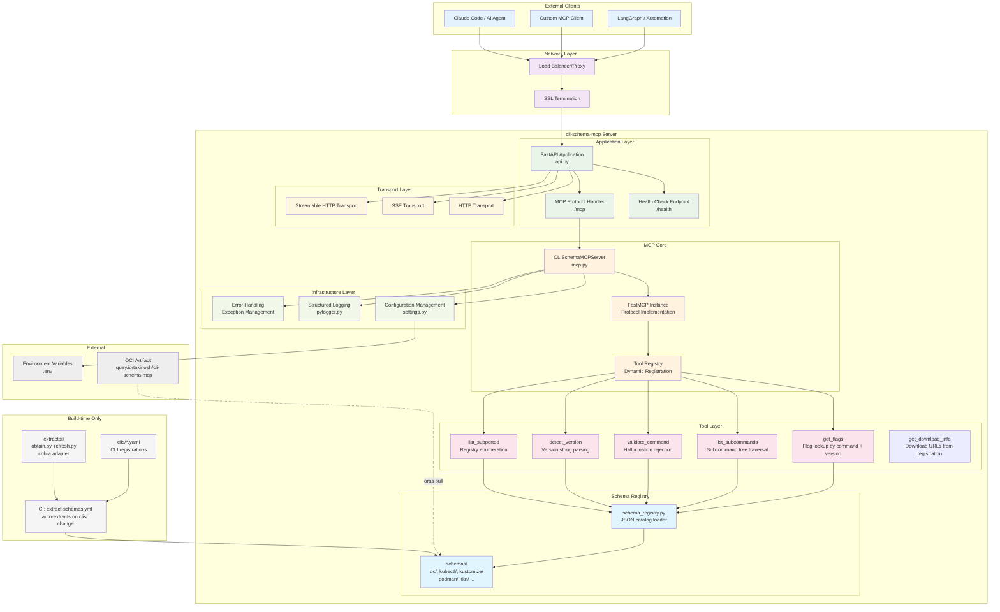
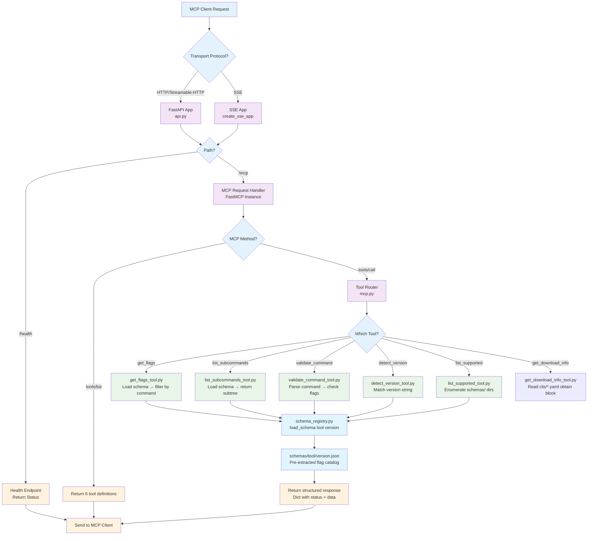

# Architecture

## System Architecture



**Key architectural invariant**: The `extractor/` package is **build-time only**. It is never imported by the MCP server at runtime. Schemas are pre-extracted JSON files on the filesystem.

## Request Flow



## Code Structure

```
cli-schema-mcp/
├── cli_schema_mcp/              # MCP server package (runtime)
│   ├── __init__.py
│   ├── src/
│   │   ├── main.py              # Application entry point
│   │   ├── api.py               # FastAPI app + transport setup
│   │   ├── mcp.py               # MCP server + tool registration
│   │   ├── schema_registry.py   # JSON catalog loader (lru_cache)
│   │   ├── settings.py          # Pydantic configuration
│   │   ├── oauth/               # OAuth integration (off by default)
│   │   ├── storage/             # PostgreSQL token storage (auth only)
│   │   └── tools/               # One file per MCP tool
│   │       ├── get_flags_tool.py
│   │       ├── list_subcommands_tool.py
│   │       ├── validate_command_tool.py
│   │       ├── detect_version_tool.py
│   │       ├── list_supported_tool.py
│   │       └── get_download_info_tool.py
│   └── utils/
│       └── pylogger.py          # Structured logging
│
├── extractor/                   # Build-time only — never imported by server
│   ├── cli_config.py            # YAML registration parser + ObtainConfig
│   ├── obtain.py                # Download, SHA-256 verify, unpack
│   ├── refresh.py               # Change detection + all-or-nothing publish
│   ├── main.py                  # python -m extractor <cli> <version>
│   └── adapters/
│       ├── cobra.py             # Cobra __complete + help-text extraction
│       └── help_parser.py       # Regex-based help text parser
│
├── clis/                        # CLI registrations (one YAML per CLI)
│   ├── oc.yaml
│   ├── kubectl.yaml
│   ├── kustomize.yaml
│   ├── podman.yaml
│   └── tkn.yaml
│
├── schemas/                     # Pre-extracted flag catalogs (committed)
│   ├── oc/          4.18.json … 4.22.json
│   ├── kubectl/     1.31.json … 1.35.json
│   ├── kustomize/   5.3.json … 5.5.json
│   ├── podman/      5.2.json … 5.4.json
│   └── tkn/         0.45.json, 0.46.json
│
├── tests/                       # Test suite (355 tests, 84%+ coverage)
├── .github/workflows/
│   ├── test.yml                 # Tests + coverage gate
│   ├── pre-commit.yml           # Linting, mypy, bandit
│   ├── extract-schemas.yml      # Auto-extract on clis/ change
│   └── publish-schemas-oci.yml  # Publish to quay.io on v* tag
├── Containerfile
├── pyproject.toml
└── README.md
```

## Key Components

- **`schema_registry.py`**: Loads `schemas/<tool>/<version>.json` with `lru_cache` on first access. `SCHEMA_REGISTRY_PATH` env var overrides the default `schemas/` directory (used with OCI pull for air-gapped deployments).
- **`mcp.py`**: Registers all six tools with FastMCP. Tools always return `Dict[str, Any]` with a `status` field and never raise.
- **`extractor/refresh.py`**: Entry point `python -m extractor.refresh --base <rev> --head <rev>`. Detects changed `clis/` registrations, downloads + verifies each declared version's binary, runs the extractor, and publishes `schemas/` only after all versions succeed (all-or-nothing).
- **`obtain.py`**: Downloads artifact from `artifact_url`, verifies SHA-256 against `checksum_url`, unpacks `raw`/`tar.gz`/`zip` formats with up to 3-layer unwrap.
- **`settings.py`**: Pydantic-based configuration. `ENABLE_AUTH` defaults to `False`. `SCHEMA_REGISTRY_PATH` overrides the schema directory.
- **`oauth/`**, **`storage/`**: OAuth 2.0 + PostgreSQL token storage — available but off by default. See [Authentication Guide](authentication.md).

## MCP Tools

| Tool | Input | Output |
|------|-------|--------|
| `get_flags` | `tool`, `version`, optional `flag_prefix` | List of flag objects (name, type, shorthand, default, deprecated) |
| `list_subcommands` | `tool`, `version`, optional `command_path` | List of subcommand names + descriptions |
| `validate_command` | `tool`, `version`, `command_string` | `valid` bool + list of invalid flags if any |
| `detect_version` | `tool` | Matched version string, or `binary_not_found` with `install_hint` when the CLI is not in PATH |
| `list_supported` | — | Dict of supported tools → version list |
| `get_download_info` | `tool`, optional `version` | Download URLs, archive format, binary path, and install guidance from `clis/<tool>.yaml` — no binary or network required |

## HTTP Endpoints

| Method | Path | Description |
|--------|------|-------------|
| `GET` | `/health` | Health check — `{"status": "healthy"}` |
| `POST` | `/mcp` | MCP JSON-RPC (tools/list, tools/call) |
| `GET` | `/.well-known/oauth-protected-resource` | RFC 8414 metadata (auth only) |
| `GET` | `/.well-known/oauth-authorization-server` | RFC 8414 metadata (auth only) |

OAuth routes (`/auth/*`) are registered only when `ENABLE_AUTH=True`.
